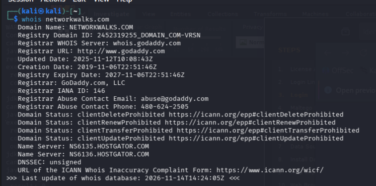
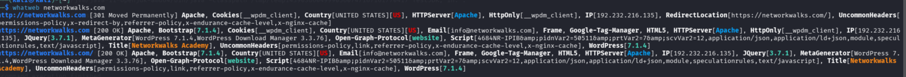
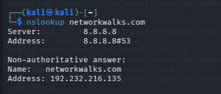
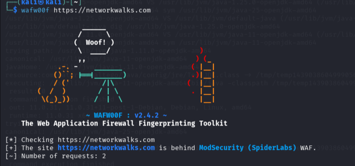
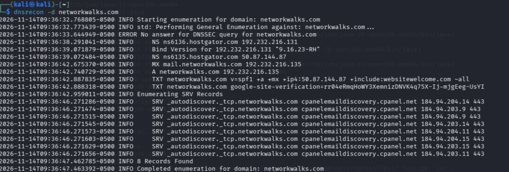
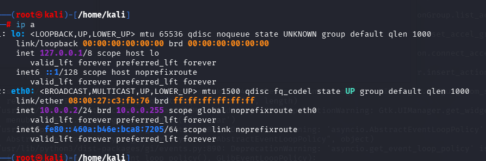
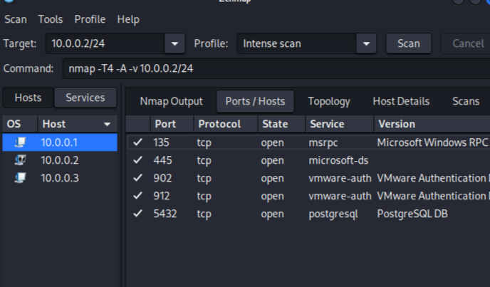
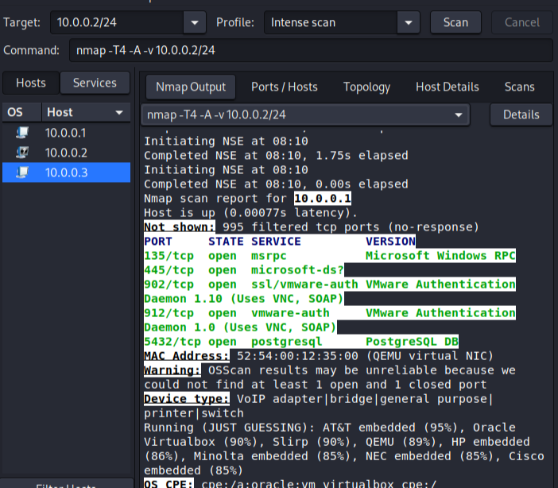

# Penetration Testing Report

**Footprinting & Network Scanning Phases**

`W2-PM-FINAL` | Cybersecurity | Networkwalks

| Field | Detail |
|---|---|
| Pentester | Zohaib |
| Program / Batch | Networkwalks Cybersecurity Internship – [Batch no.] |
| Date | 14 November 2026 |
| Modules completed | W2-PM1 (Multiple Kali Tools), W2-PM5 (Zenmap Network Scanning) |
| Targets | `networkwalks.com` (192.232.216.135) and own lab subnet `10.0.0.0/24` |
| Authorization | Letter of Authorization, Ref. [NW-LOA-xxxx] |
| Platform | Kali Linux (VirtualBox VM) |

---

## 1. Liability Disclaimer

All testing was done only against systems named in the Letter of Authorization: the client's own public website and DNS records, and the tester's own local network. Only passive and light information-gathering and host-discovery techniques were used. No exploitation, brute force, denial of service, or data access was attempted. Findings are confidential and for educational use within the internship.

## 2. Introduction

This report covers Phase 1 (Footprinting and Reconnaissance) and Phase 2 (Network Scanning). Six Kali tools were used against `networkwalks.com`, then Zenmap was used to scan the tester's own lab subnet.

## 3. Tools Used

| Tool | Purpose |
|---|---|
| `whois` | Registration, registrar, name servers, domain status |
| `whatweb` | Web technology / CMS fingerprinting |
| `nslookup` | DNS resolution |
| `curl -I` | HTTP header inspection |
| `wafw00f` | WAF detection |
| `dnsrecon` | DNS record enumeration |
| `ip a` | Identify tester interface and subnet |
| Zenmap / Nmap | Host discovery, port and service scan |

---

## 4. Activities Performed

### 4.1 Footprinting and Reconnaissance (W2-PM1)

#### 4.1.1 whois

```bash
whois networkwalks.com
```



- Registrar: GoDaddy.com, LLC (IANA ID 146)
- Created 2019-11-06, updated 2025-11-12, expires 2027-11-06
- Registrant hidden by privacy service (Domains By Proxy, LLC)
- All four client locks set (delete, renew, transfer, update prohibited)
- Name servers: NS6135/NS6136.HOSTGATOR.COM at the registry; the registrar record also lists NS29/NS30.DOMAINCONTROL.COM
- DNSSEC: unsigned

#### 4.1.2 whatweb

```bash
whatweb networkwalks.com
```



- HTTP 301 redirects to HTTPS (200 OK)
- Apache, WordPress 7.1.4, WordPress Download Manager 3.3.76, jQuery 3.7.1, Bootstrap, Google Tag Manager
- Title "Networkwalks Academy", email `info@networkwalks.com` visible
- IP 192.232.216.135 (US); cookie `__wpdm_client` is HttpOnly
- Note: the `Bootstrap[7.1.4]` match looks like a mis-detection

#### 4.1.3 nslookup

```bash
nslookup networkwalks.com
```



Resolves to `192.232.216.135` via 8.8.8.8.

#### 4.1.4 curl -I

```bash
curl -I https://networkwalks.com
```


- `HTTP/1.1 200 OK`, `Server: Apache`
- `Permissions-Policy` and `Referrer-Policy: no-referrer-when-downgrade` set
- `Set-Cookie` has Secure and HttpOnly
- `Link` header exposes `/wp-json/` (WordPress REST API)
- No HSTS, CSP, X-Frame-Options or X-Content-Type-Options seen in this HEAD response (verify with a full GET)

#### 4.1.5 wafw00f

```bash
wafw00f https://networkwalks.com
```



Site is behind a **ModSecurity (SpiderLabs)** WAF (2 requests).

#### 4.1.6 dnsrecon

```bash
dnsrecon -d networkwalks.com
```



| Record | Value |
|---|---|
| SOA | ns6135.hostgator.com (50.87.144.87) |
| NS | ns6136.hostgator.com (192.232.216.131), ns6135.hostgator.com (50.87.144.87) |
| A | 192.232.216.135 |
| MX | mail.networkwalks.com (192.232.216.135) |
| TXT (SPF) | `v=spf1 +a +mx +ip4:50.87.144.87 +include:websitewelcome.com ~all` |
| TXT | google-site-verification token |
| SRV | `_autodiscover._tcp` → cpanelemaildiscovery.cpanel.net:443 |

- 8 records found; DNSSEC query got no answer
- Both name servers disclose BIND version `9.16.23-RH`
- SPF uses soft fail (`~all`); DMARC/DKIM were not enumerated

---

### 4.2 Network Scanning with Zenmap (W2-PM5)

#### 4.2.1 Tester interface

```bash
ip a
```



Kali `eth0` = `10.0.0.2/24` (MAC 08:00:27:c3:fb:76), so the subnet is `10.0.0.0/24`.

#### 4.2.2 Scan

Zenmap profile: **Intense scan**

```bash
nmap -T4 -A -v 10.0.0.2/24
```



Three hosts up: `10.0.0.1`, `10.0.0.2` (Kali itself), `10.0.0.3`.

#### 4.2.3 Host 10.0.0.1

| Port | State | Service | Version |
|---|---|---|---|
| 135/tcp | open | msrpc | Microsoft Windows RPC |
| 445/tcp | open | microsoft-ds | SMB |
| 902/tcp | open | ssl/vmware-auth | VMware Authentication Daemon 1.10 |
| 912/tcp | open | vmware-auth | VMware Authentication Daemon 1.0 |
| 5432/tcp | open | postgresql | PostgreSQL DB |



995 other TCP ports filtered. MAC `52:54:00:12:35:00` is a QEMU virtual NIC; OS detection was unreliable (VirtualBox/Slirp/QEMU guesses). This fits the VirtualBox virtual gateway in front of a Windows host running VMware services, PostgreSQL and SMB.

#### 4.2.4 Host 10.0.0.3

[Add open ports/services for 10.0.0.3 and a screenshot.]

---

## 5. Summary of Findings

| # | Finding | Target | Risk |
|---|---|---|---|
| 1 | WordPress and plugin versions disclosed | networkwalks.com | Low |
| 2 | REST API location advertised in `Link` header | networkwalks.com | Info |
| 3 | Security headers not seen in HEAD response | networkwalks.com | Low |
| 4 | DNSSEC not enabled | networkwalks.com | Low |
| 5 | BIND version disclosed by name servers | HostGator NS | Low |
| 6 | SPF soft fail; DMARC/DKIM not checked | networkwalks.com | Low |
| 7 | Name server lists differ (registry vs registrar) | networkwalks.com | Info |
| 8 | Contact email visible on site | networkwalks.com | Info |
| 9 | PostgreSQL (5432) reachable | 10.0.0.1 | Medium (lab) |
| 10 | SMB (445) and RPC (135) reachable | 10.0.0.1 | Medium (lab) |
| 11 | VMware auth ports (902/912) reachable | 10.0.0.1 | Low (lab) |
| 12 | Good practice: ModSecurity WAF, HTTPS redirect, registrar locks, WHOIS privacy | networkwalks.com | Positive |

## 6. Recommendations

1. Hide WordPress generator and plugin version strings; keep core and plugins patched.
2. Add HSTS, CSP, X-Frame-Options and X-Content-Type-Options headers.
3. Enable DNSSEC and confirm the intended name server set.
4. Ask the host to hide BIND version info.
5. Review SPF (consider `-all`) and publish DKIM and DMARC.
6. Limit the REST API where not needed; use a contact form instead of a plain email.
7. On the lab host: bind PostgreSQL to localhost, restrict SMB/RPC with the firewall, close VMware auth ports when idle.

## 7. Conclusion

networkwalks.com runs WordPress on shared HostGator infrastructure behind a ModSecurity WAF, with good domain protections but some avoidable information disclosure. The lab scan found three live hosts, with several services on `10.0.0.1` that should be restricted. Only passive and light techniques were used and nothing was exploited.

---

*Educational use only. Performed under written authorization within the Networkwalks Cybersecurity Internship.*
