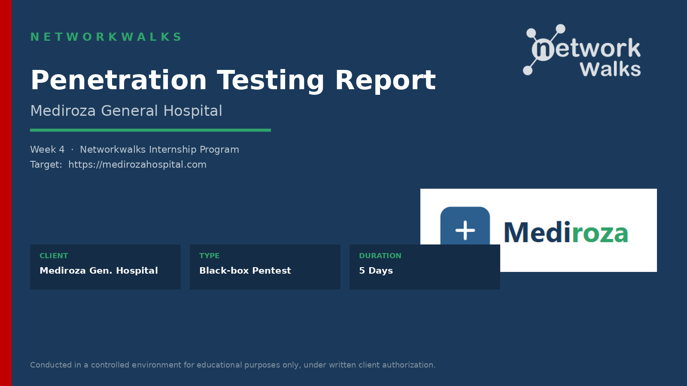

# Networkwalks Internship — Week 4 Penetration Test
## Target: Mediroza General Hospital (medirozahospital.com)

> Conducted in a controlled training environment under written client authorization (Networkwalks Penetration Testing Project, Week 4). Techniques documented here were performed **only** against the authorized lab target and must never be used against a system without explicit written permission.

## Overview

| | |
|---|---|
| **Client** | Mediroza General Hospital |
| **Engagement type** | Black-box penetration test |
| **Duration** | 5 days |
| **Target** | https://medirozahospital.com |
| **Authorization** | Written permission granted (Networkwalks M1–M3) |

## Objective

Four milestones, completed in order:

1. **M1 – Initial Access:** Attack the site and retrieve 3 confidential patient PDF lab reports.
2. **M2 – Data Extraction:** Crack the encryption on all 3 retrieved files.
3. **M3 – Critical Exposure:** Use the retrieved data to uncover staff salaries and shareholder details.
4. **M4 – Reporting:** Write a professional penetration testing report.

## Summary of Findings

| # | Finding | Risk |
|---|---|---|
| F1 | SQL injection (`admin' --`) bypassed Patient Portal authentication | Critical |
| F2 | Public database backup (`/old/mediroza_db_backup_2019.sql`) exposed via directory listing | Critical |
| F3 | All 3 patient PDF reports encrypted with weak, dictionary-crackable passwords (`123456`, `password`, …) | High |
| F4 | `robots.txt` disclosed sensitive paths (`/patient/`, `/staff/`, `/old/`) instead of protecting them | Medium |
| F5 | Server/version banner disclosure (LiteSpeed, verbose headers) | Low |

## Methodology

1. **Reconnaissance** — `whois`, `whatweb`, `katana` crawl to map endpoints and technology stack.
2. **Exploitation (M1)** — SQL injection auth bypass on `/patient/login.php` using `admin' --`, granting access to 3 confidential pathology PDF reports.
3. **Cracking (M2)** — Extracted each PDF's encryption hash (`$pdf$2*3*128*...`) and ran a Hashcat dictionary attack (100-word built-in list), recovering each file's password within 1–2 attempts.
4. **Exposure discovery (M3)** — Found `/old/` referenced in `robots.txt`; directory listing was enabled, exposing `mediroza_db_backup_2019.sql` — a full HR database dump with 30 staff records (names, emails, phones, national IDs, salaries) and 10 shareholder records (equity stakes, share classes). Used AI-assisted analysis to summarize payroll totals, equity structure, and data anomalies.
5. **Reporting (M4)** — Findings consolidated into a full penetration test report (executive summary, methodology, findings with proof, risk ratings, remediation).

## Key Data Points (from the exposed backup)

- 30 staff records across 17 departments; 10 shareholders holding 1,000,000 shares total.
- Total monthly payroll: **R2,027,000** (≈R24.3M annualised).
- Top earners: Dr. Johan van der Merwe (Medical Director, R160,000/mo), Sarah Botha (CFO, R152,000/mo), Dr. Rajesh Naidoo (Chief Pathologist, R138,000/mo).
- 8 of 10 shareholders are also staff members (74% of shares); Cedar Health Holdings (15%) and the Reddy Family Trust (11%) are external holders.

## Deliverables

- **`Networkwalks_Week4_Penetration_Testing_Report_Mediroza.pdf`** — the submission-ready report, fully laid out in the Networkwalks/Mediroza brand (cover, milestone-coded finding pages, risk table, remediation) — 10 pages, matching the Week 4 project deck's colors, logo placement, and layout.
- **[Editable working doc](https://claude.ai/artifact/PJBJCVfEJJx31D58kFWek2)** — the same report content as a live Claude Doc, for comments/edits before final submission.
- `README.md` — this file.
- `cover_banner.png` — branded cover graphic (Networkwalks + Mediroza logos, brand colors).
- Screenshots of each milestone (recon, SQLi bypass, crawl, cracking, recovered PDFs, directory listing, exposed SQL dump) retained as evidence.

## Disclaimer

This work was performed strictly within the scope of an authorized educational penetration-testing exercise (Networkwalks Internship, Week 4) against a designated lab target. No part of this document or the techniques it describes should be applied to any system without explicit, documented, written permission from its owner.
